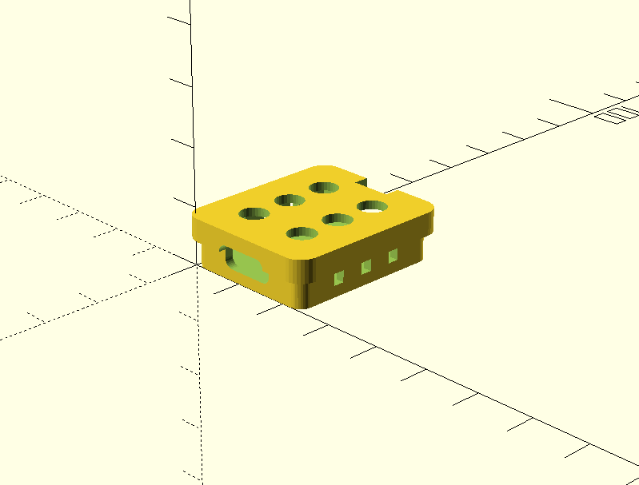
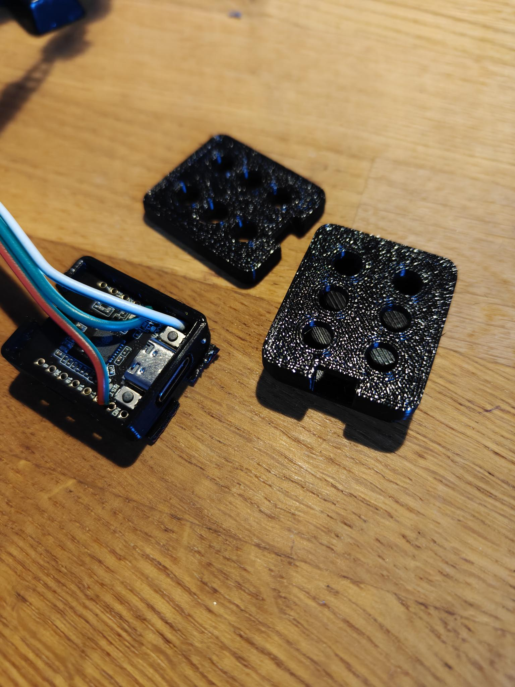

# TLED - Matter-over-Thread LED Controller

A Matter-compatible LED strip controller for ESP32-C6 that works over Thread networking. Control addressable LED strips (WS2812B, SK6812, WS2805, etc.) from Home Assistant, Apple Home, Google Home, or any Matter-compatible smart home platform.

## Features

- **Matter over Thread** - Native Matter protocol, no cloud or WiFi required
- **Full RGB + RGBW control** - Color picker, brightness, on/off from your smart home app
- **Tunable white on SK6812 RGBW** - Warm/cool white (2000K-6500K) via a native color temperature control, using the W LED as the main white source
- **RGBCCT (WS2805) support** - Tunable white (3000K-6500K) via a native color temperature slider, plus full RGB color
- **Smooth transitions** - 300ms fades on all changes
- **Thread mesh networking** - Self-healing network, device acts as a router
- **Web-based installer** - Flash firmware directly from your browser
- **USB configuration** - Change settings via serial without recompiling
- **NVS persistence** - Settings survive reboots
- **Temperature monitoring** - Chip temperature exposed to Home Assistant
- **Health monitoring** - Watchdog timer, heap tracking, auto-reboot on hang
- **Power-on behavior** - Configurable: restore last state, always on, or always off
- **Built-in effects** - Rainbow, breathing, candle, chase (implemented but not yet user-accessible, untested)

## Hardware

This project was developed for the **[DFRobot Beetle ESP32-C6](https://wiki.dfrobot.com/SKU_DFR1117_Beetle_ESP32_C6)** - a tiny 25mm × 20.5mm board that's perfect for embedding in LED strip projects. Any ESP32-C6 board should work, but the Beetle's small size makes it ideal.

### Requirements

- **ESP32-C6 board** - DFRobot Beetle ESP32-C6 recommended (or any ESP32-C6)
- **Addressable LED strip** - WS2812B, WS2811, SK6812 (RGBW), or WS2805 (RGBCCT)
- **Power supply** - 5V for WS2812B/SK6812, 12V or 24V for WS2805; size for your LED count (~60mA per LED at full white on 5V strips)
- **Thread border router** - HomePod Mini, Apple TV 4K, Google Nest Hub, or dedicated like SLZB-06/SMLight

### 3D Printable Enclosure

A parametric OpenSCAD enclosure design is included in the `enclosure/` folder, sized specifically for the DFRobot Beetle ESP32-C6.

<p align="center">
  
  
</p>

**Features:**
- **Friction-fit lid** - No screws needed, snaps securely in place
- **USB-C port cutout** - Easy access for flashing and power
- **Wire slit** - Solder your wires first, then slide them into the enclosure
- **Super compact** - Just slightly larger than the Beetle board itself

Ready-to-print STL files (`tled_base.stl`, `tled_lid.stl`) are included in the `enclosure/` folder. If you want to tweak dimensions, open `tled_enclosure.scad` in [OpenSCAD](https://openscad.org/) - it's fully parametric so you can adjust wall thickness, tolerances, and ventilation hole sizes.

**Printing tips:**
- Print the base upside-down (opening facing up)
- 0.2mm layer height works well
- No supports needed
- PLA or PETG recommended

## Quick Start

### 1. Flash the Firmware

Visit the **[Web Installer](https://maui1911.github.io/TLED)** and click "Install TLED Firmware".

> **Note:** Requires Chrome or Edge browser. If prompted, hold the BOOT button on your ESP32-C6 while clicking Install.

### 2. Configure Your LED Strip

1. Go to the **Configure** tab in the web installer
2. Click **Connect to Device**
3. Set your LED count, GPIO pin, and LED type
4. Click **Save & Reboot**

### 3. Commission to Your Smart Home

After reboot, a QR code will appear in the web installer. Scan it with:
- **Home Assistant** - Settings → Devices & Services → Add Integration → Matter
- **Apple Home** - Add Accessory → Scan QR Code
- **Google Home** - Add Device → Matter-enabled device

## Configuration Options

| Setting | Default | Description |
|---------|---------|-------------|
| LED Count | 10 | Number of LEDs in your strip (1-1000). For WS2805 this is the number of ICs (addressable groups of ~6 LEDs), not individual LEDs |
| GPIO Pin | 5 | Data pin connected to LED strip |
| LED Type | WS2812B | Chipset: WS2812B, WS2811, SK6812 (RGBW), or WS2805 (RGBCCT) |
| RGB Order | GRB | Color byte order (try others if colors are wrong) |
| Max Brightness | 255 | Limits maximum brightness (saves power) |
| White Mode | accurate | SK6812 RGBW white mixing: accurate, brighter, none, dual, or max |
| Manual White | 0 | Manual SK6812 white channel level used by none/dual modes |
| Channel Gains | 255 | Per-channel RGBW calibration gain (0-255) |
| BIN GPIO | off | WS2805 only: optional GPIO for the BIN backup data line |
| White Order | ww_cw | WS2805 only: which wire channel is warm vs cool white |
| White Temp | 4000K | SK6812 only: color temperature of the strip's W LED, used for white mixing |
| Device Name | TLED | Name shown in your smart home app |
| Power-on | restore | Behavior on power up: restore last state, on, or off |

## Wiring

```
ESP32-C6          LED Strip
─────────         ─────────
GPIO 5    ────────  DIN (Data In)
GND       ────────  GND
                    5V  ──── External 5V Power Supply
```

> **Important:** Power your LED strip from an external 5V supply, not from the ESP32's 5V pin (except for very short strips).

### WS2805 (RGBCCT) wiring

WS2805 strips run on 12V or 24V, but the data lines are ordinary logic-level signals - the ESP32-C6 drives them directly. **Never connect the strip's 12/24V to the ESP32.** The grounds must be shared.

```
ESP32-C6          WS2805 Strip
─────────         ────────────
GPIO 5    ────────  DIN (Data In)
GPIO 4    ────────  BIN (Backup Data In, optional - see below)
GND       ────────  GND ──── also to Power Supply GND
                    12V/24V ──── External 12V/24V Power Supply
```

- **BIN (backup data):** the WS2805 has a second data input that lets the chain survive a single dead IC. Either configure a second GPIO with `set bin <pin>` (the firmware mirrors the exact DIN waveform to it), tie the strip's BIN to DIN at the connector, or leave it unconnected.
- **Addressability:** one WS2805 IC controls a group of LEDs (typically 6 on 24V strips). Set `leds` to the number of ICs, not the number of LEDs. E.g. a 1m/60-LED 24V strip has 10 ICs → `set leds 10`.
- **Wrong warm/cool white?** If warm and cool are swapped, run `set white_order cw_ww`.

## Serial Commands

Connect via USB and use the serial console in the web installer, or any serial terminal at 115200 baud:

```
help                    Show available commands
config                  Show current configuration
set leds <n>            Set number of LEDs (1-1000)
set gpio <n>            Set data GPIO pin
set type <type>         Set LED type (ws2812b/ws2811/sk6812/ws2805)
set order <order>       Set RGB order (grb/rgb/brg/rbg/bgr/gbr)
set bin <n|off>         WS2805 BIN backup data GPIO (off = disabled)
set white_order <o>     WS2805 white channel order (ww_cw/cw_ww)
set white_temp <k>      SK6812 W LED color temperature in Kelvin (1000-20000)
set brightness <1-255>  Set max brightness
set name <name>         Set device name
set poweron <mode>      Power-on behavior (restore/on/off)
set white_mode <mode>   RGBW white mode (accurate/brighter/none/dual/max)
set white <0-255>       Manual RGBW white channel level
set gain_r <0-255>      Red channel gain
set gain_g <0-255>      Green channel gain
set gain_b <0-255>      Blue channel gain
set gain_w <0-255>      White channel gain
save                    Save configuration and reboot
reboot                  Restart device
factory                 Factory reset (erases settings & commissioning)
```

### Matching WLED

For SK6812 RGBW strips, TLED defaults to `white_mode accurate`, matching WLED's accurate auto-calculated white behavior by extracting the common RGB component into the white channel. Use `set white_mode brighter` if WLED is set to the brighter auto-calculate mode, `set white_mode none` for RGB plus a fixed manual white level, `set white_mode dual` to use manual white when nonzero and otherwise fall back to brighter mode, or `set white_mode max` to drive white from the strongest RGB channel.

To match an existing WLED installation, compare these settings first:

- **Auto-calculate white channel from RGB:** start with `accurate`, then try `brighter` if the strip is dimmer than WLED.
- **RGB order:** use `set order grb|rgb|brg|rbg|bgr|gbr` until red, green, and blue match.
- **Brightness limiter:** match WLED's current limit with `set brightness <1-255>`, or leave both unlimited for calibration.
- **White, gamma, and correction:** TLED applies only manual white and linear per-channel gains; disable WLED color correction/gamma while matching, or compensate with `gain_r`, `gain_g`, `gain_b`, and `gain_w`.
- **Matter capability changes:** if a firmware update changes exposed Matter capabilities, Home Assistant keeps the old ones until you run **Re-interview device** and then reload the Matter integration. Other controllers may need the device removed and re-paired.

### SK6812 color temperature

Matter has no RGBW channel, so TLED exposes the W LED through a native Matter **Color Temperature** control (153-500 mireds ≈ 6500K-2000K) alongside the color picker. The W LED is the main white source and RGB only fills in what it cannot reach, so output is pure W at the strip's native temperature. Tell TLED what that is with `set white_temp <kelvin>`; warm white strips are typically around 3000K, cool white around 6000K.

The `white_mode`, `white` and gain settings apply to color mode; the channel gains and brightness limit apply in color temperature mode too.

### WS2805 color temperature

WS2805 strips have dedicated warm (3000K) and cool (6500K) white channels, so TLED exposes a native Matter **Color Temperature** control (153-333 mireds ≈ 6500K-3000K) alongside the color picker:

- **White/CT mode:** the warm and cool channels are mixed to hit the requested temperature; RGB stays off.
- **Color mode:** RGB renders the chosen color; the white channels stay off.

> **Note:** switching between a strip with a white source (`sk6812`, `ws2805`) and one without changes the device's Matter clusters. Remove and re-add the device in your smart home app after changing it.

## Building from Source

### Prerequisites

- [ESP-IDF v5.4.1](https://docs.espressif.com/projects/esp-idf/en/latest/esp32c6/get-started/)
- [ESP-Matter](https://github.com/espressif/esp-matter) at commit `1f50e4e` (main, February 2026). Older releases such as `release/v1.4.2` do not build: the color temperature API differs.

### Build & Flash

```bash
# Source the environments
source ~/esp/esp-idf/export.sh
source ~/esp/esp-matter/export.sh

# Build
idf.py build

# Flash (keeps commissioning data)
idf.py -p /dev/ttyACM0 flash

# Flash with erase (clears commissioning - need to re-pair)
idf.py -p /dev/ttyACM0 erase-flash flash

# Monitor serial output
idf.py -p /dev/ttyACM0 monitor
```

### Configuration via menuconfig

```bash
idf.py menuconfig
# Navigate to "TLED Configuration" for build-time defaults
```

## Troubleshooting

### Can't flash the device
- Use Chrome or Edge (Firefox doesn't support Web Serial)
- Hold the BOOT button while clicking Install
- Try a different USB cable (some are charge-only)

### "No bootable app partitions" / Boot loop
- Flash was interrupted. Try flashing again.

### Can't find device during commissioning
- Commission within 30 seconds of boot (BLE advertising slows down)
- Run `factory` command if device was previously commissioned
- Move closer to your Thread border router

### Wrong colors
- Try different RGB Order settings (GRB → RGB → BGR → RBG)

### LEDs don't light up
- Check 5V power supply connection
- Verify GPIO pin matches your wiring
- Confirm LED count is correct

## Project Structure

```
TLED/
├── main/
│   ├── app_main.cpp            # Matter setup, endpoint creation
│   ├── app_driver.cpp          # LED strip driver, transitions, effects
│   ├── ws2805_strip.c          # WS2805 5-channel (RGBCCT) RMT driver
│   ├── app_nvs_config.cpp      # Runtime configuration storage
│   ├── app_serial_config.cpp   # USB serial command interface
│   ├── app_monitoring.cpp      # Health monitoring, watchdog, temperature
│   ├── app_device_info.cpp     # Matter device branding
│   ├── app_ble_config.cpp      # BLE commissioning configuration
│   └── Kconfig.projbuild       # Build-time configuration options
├── web-installer/
│   ├── index.html              # Web installer & configurator
│   └── manifest.json           # ESP Web Tools manifest
├── enclosure/
│   ├── tled_enclosure.scad     # OpenSCAD parametric enclosure design
│   ├── tled_base.stl           # Pre-exported base STL
│   └── tled_lid.stl            # Pre-exported lid STL
├── partitions.csv              # Flash partition layout
└── sdkconfig.defaults          # Default SDK configuration
```

## License

MIT License - see [LICENSE](LICENSE) for details.

## Acknowledgments

- [ESP-Matter](https://github.com/espressif/esp-matter) - Espressif's Matter SDK
- [ESP Web Tools](https://esphome.github.io/esp-web-tools/) - Browser-based flashing
- [ConnectedHomeIP](https://github.com/project-chip/connectedhomeip) - Matter protocol implementation
